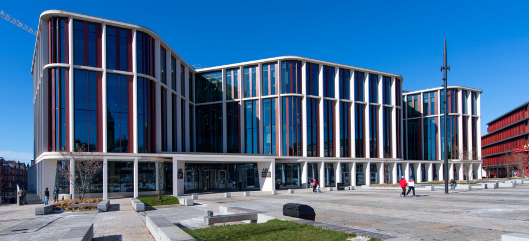
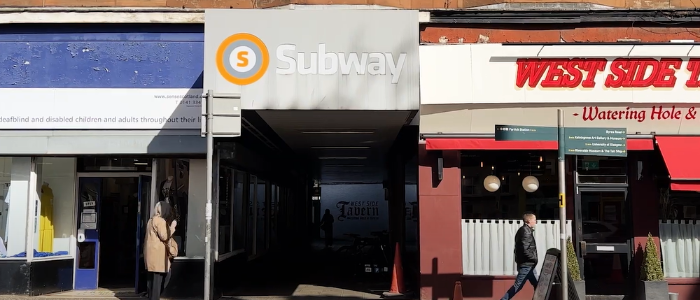
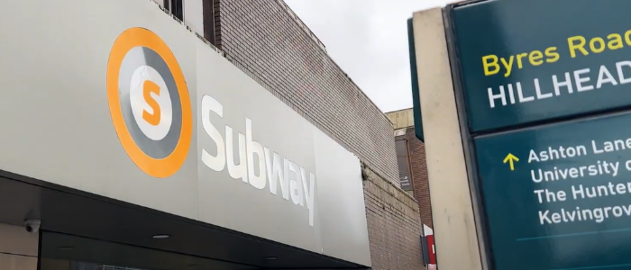

::: {.hero}

::: {.hero-top}
[Glasgow · 26–27 November 2026]{.eyebrow}

# Getting there

**Mazumdar-Shaw Advanced Research Centre (ARC)**, University of Glasgow, 11 Chapel Lane, Glasgow G11 6EW.
Nearest Subway station: **Kelvinhall** (about 5 minutes on foot).

[Open in Google Maps](https://goo.gl/maps/DbjyvBYBZwK4e5JG7){.cta target="_blank"}
:::

::: {.hero-body}

{.venue-photo fig-alt="The ARC, a curved glass-and-white building, against a clear blue sky"}

## In short

::: {.why-grid}
::: {.why-card}
### When
Thursday 26 and Friday 27 November. Doors open at **09:00**; both days end at **18:00**.
:::

::: {.why-card}
### Where
The ARC is in Glasgow's **West End**, on the University campus between Byres Road and Dumbarton Road.
Come in through the main entrance on the square; the ground floor is step-free.
:::

::: {.why-card}
### How
From the city centre, take the **Subway** (Glasgow's circular underground line) to **Kelvinhall** or **Hillhead**
and walk. No car needed: there is no public parking on campus.
:::
:::

## Your route, step by step

### 1 · Into Glasgow

::: {.landscape .routes}
| Arriving at | Then |
|---|---|
| **Glasgow Airport** (GLA) | First Bus **77** runs directly to the West End. A taxi to the West End costs roughly £21. |
| **Edinburgh Airport** (EDI) | **Citylink Air** coach to **Buchanan Bus Station** in Glasgow city centre, then the Subway from **Buchanan Street** (step 2). |
| **Glasgow Queen Street** (trains from Edinburgh, the north) | Walk 2 minutes to **Buchanan Street** Subway station (step 2). |
| **Glasgow Central** (trains from England, the south-west) | Walk about 5 minutes to **St Enoch** Subway station (step 2). |
| **Partick** (local trains) | Partick is about a mile west of campus: walk 20 minutes, or take the Subway one stop to Kelvinhall. |
:::

### 2 · Subway to the West End

The Subway is a single loop with 15 stations; trains run every few minutes, so you cannot get lost.
From **Buchanan Street** or **St Enoch**, ride to **Kelvinhall** (via Hillhead, the shorter way round).
Hillhead is one stop earlier and works just as well.

Buses: routes **4, 4A** and **15** run from the city centre through the main campus; others stop on
Dumbarton Road, Great Western Road and Byres Road.

### 3 · Walk to the ARC

The University filmed the walk from both stations. Watch it once before you set off:

::: {.why-grid}
::: {.why-card}
[{fig-alt="Kelvinhall Subway entrance on Dumbarton Road"}](https://youtu.be/dIMFPwFlQzM){target="_blank"}

**From Kelvinhall** · about 5 minutes · [watch the walk](https://youtu.be/dIMFPwFlQzM){target="_blank"}
:::

::: {.why-card}
[{fig-alt="Hillhead Subway entrance on Byres Road with a sign to the University"}](https://youtu.be/hzEy2V9KKtk){target="_blank"}

**From Hillhead** · about 10 minutes · [watch the walk](https://youtu.be/hzEy2V9KKtk){target="_blank"}
:::
:::

::: {.venue-map}
<iframe title="Map of the ARC and the nearby Subway stations" loading="lazy"
  src="https://www.openstreetmap.org/export/embed.html?bbox=-4.3040%2C55.8690%2C-4.2890%2C55.8770&amp;layer=mapnik&amp;marker=55.87159%2C-4.29574"></iframe>

[View a larger map](https://www.openstreetmap.org/?mlat=55.87159&mlon=-4.29574#map=17/55.87159/-4.29574){target="_blank"} ·
[University campus map (PDF)](https://www.gla.ac.uk/media/Media_1167819_smxx.pdf){target="_blank"}
:::

## Good to know

- **Late November in Glasgow** is dark by about 4 pm and often wet. Bring a rain jacket.
- **Arriving by car:** campus parking is for permit holders only. The Subway's Park & Ride at
  **Kelvinbridge** costs around £5 and is a short ride (or a walk) away.
- **Cycling:** a cycle route connects the city centre with the University.
- **Accessibility:** the ground floor (Level 2) has step-free access, induction loops and a Changing
  Places toilet on Level 1. The nearest Blue Badge bay is on University Place; drop-offs can be arranged
  via [arc-enquiries@glasgow.ac.uk](mailto:arc-enquiries@glasgow.ac.uk).
- **Lost on the day?** Ask in the [Matrix room](https://matrix.to/#/#rse-hackathon-glasgow-:matrix.org),
  or contact the [organisers](contacts.html). ARC reception: +44 141 330 4170.

Travel details are taken from the University of Glasgow's
[ARC contact](https://www.gla.ac.uk/research/arc/contact/) and
[how to get here](https://www.gla.ac.uk/explore/maps/howtogethere/) pages; check
[SPT](https://www.spt.co.uk/subway/) for current Subway times.
:::

:::
